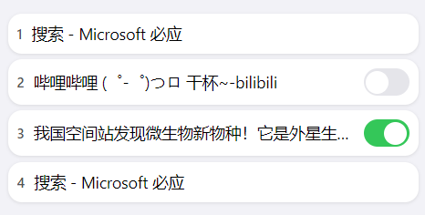

# 媒体播放监控 · Check Media Playback

[返回项目总览](../README.md)

为手动选中的浏览器标签页检查音视频状态，发现暂停时尝试恢复播放。支持 Chrome / Edge 和 Firefox，可用于哔哩哔哩等使用 HTML 音视频元素的网页。

## 功能

- 按标签页开启或关闭监控，仅为已开启的页面创建定时检查任务。
- 每秒检查一次页面中的 `audio`、`video` 元素，尝试恢复暂停的媒体。
- 可配置 CSS 选择器，在恢复播放时隐藏匹配的遮罩元素。
- 关闭扩展弹窗后继续监控，重启浏览器后等待手动重新开启。
- 保存遮罩选择器和启用偏好，运行中的标签页任务仅在当前浏览器会话内保留。

## 预览



## 安装

浏览器扩展无需构建，直接加载对应目录即可。Chrome 版清单要求 Chrome 102 及以上；Firefox 版要求 Firefox 91.0 及以上。

### Chrome / Edge

1. 打开 `chrome://extensions/` 或 `edge://extensions/`。
2. 开启「开发者模式」，点击「加载已解压的扩展程序」。
3. 选择本项目的 `chrome/` 目录，即仓库中的 `bilibili-monitor/chrome/`。

### Firefox

1. 打开 `about:debugging#/runtime/this-firefox`。
2. 点击「临时载入附加组件」。
3. 选择 `bilibili-monitor/firefox/manifest.json`。

临时加载的扩展会在 Firefox 重启后移除，需要重新加载。

## 使用

1. 打开含有音频或视频的普通网页，等待媒体元素加载。
2. 点击扩展图标，找到对应标签页，打开右侧开关。
3. 页面暂停时，扩展会尝试恢复播放；关闭开关即可停止监控。
4. 关闭弹窗不会停止任务，再次打开时会显示实际监控状态。

开启监控后，手动暂停的媒体也会被尝试恢复。如需暂停观看，应先关闭该标签页的监控。

### 遮罩设置

在弹窗的「Mask element」中填写 CSS 选择器，例如 `.bili-mini-mask`，并勾选「启用」。设置会自动保存，并应用到当前已监控的标签页。

遮罩处理在检测到媒体暂停、尝试恢复播放时执行，通过 `display: none` 隐藏首个匹配元素。「启用」只保存偏好，不会自动开启标签页监控。

### 配置与运行状态

| 数据或操作 | 关闭弹窗 | 退出并重新打开浏览器 |
| --- | --- | --- |
| CSS 选择器、遮罩启用偏好 | 保留 | 保留 |
| 已开启的标签页监控任务 | 继续运行 | 清空，需手动开启 |
| 临时运行数据 | 随当前任务保留 | 清空 |

关闭标签页会清理其任务；刷新或导航已监控的标签页时，会在当前会话内尝试恢复监控。升级旧版本时，会删除原先永久保存的标签页勾选状态，保留选择器和遮罩偏好。

## 使用范围

- 支持读取和控制页面中的 HTML `audio`、`video` 元素；恢复播放仍受浏览器自动播放策略和网站播放器行为影响。
- 浏览器内部页面和其他禁止脚本注入的页面无法监控；未检测到媒体且尚未监控的页面不显示开启开关。
- 扩展使用标签页、脚本注入和存储权限来检测媒体、协调任务并保存设置，无需配置外部服务。

## 源码结构

```text
bilibili-monitor/
├── chrome/              # Chrome / Edge，Manifest V3
│   ├── background.js    # 会话任务协调与配置同步
│   ├── content.js       # 媒体检测、定时恢复与遮罩处理
│   ├── popup.html       # 弹窗界面
│   ├── popup.js         # 标签页开关与遮罩设置
│   ├── manifest.json
│   └── icons/
├── firefox/             # Firefox，Manifest V2，同类文件布局
├── docs/preview.png
└── README.md
```

## 许可证

[MIT License](../LICENSE)
