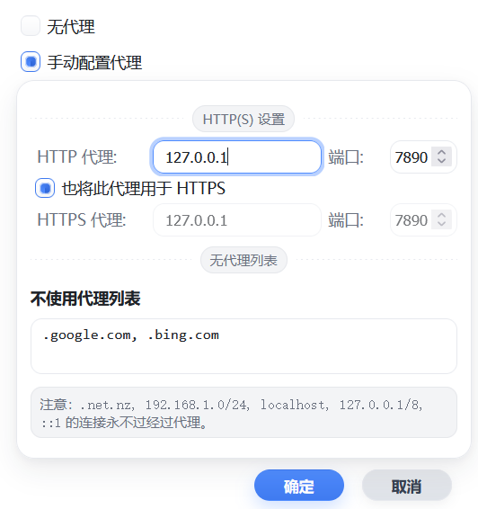

# 浏览器代理 · Browser_Proxy_Plugin

[返回项目总览](../README.md)

参考 Firefox 网络设置界面的轻量浏览器代理扩展，使用原生 HTML 和 JavaScript 实现。支持手动配置 HTTP 代理、切换代理开关和设置绕过地址。

## 功能

- 在扩展弹窗中填写代理主机和端口，点击「应用」生效。
- 切换「不使用代理」与「手动代理」。
- 配置不经过代理的地址列表，并自动合并内置绕过规则。
- 通过浏览器的 `storage.sync` 保存配置。

Chrome / Edge 与 Firefox 的代理实现不同，HTTPS 配置行为见下表。当前代码没有实现 SOCKS 配置。

## 预览



## 安装

扩展无需构建，直接加载对应浏览器的源码目录。

### Chrome / Edge

1. 打开 `chrome://extensions/` 或 `edge://extensions/`。
2. 开启「开发者模式」，点击「加载已解压的扩展程序」。
3. 选择仓库中的 `http-proxy/chrome/` 目录。

### Firefox

Firefox 版清单要求 Firefox 91.1.0 及以上。

1. 打开 `about:debugging#/runtime/this-firefox`。
2. 点击「临时载入附加组件」。
3. 选择 `http-proxy/firefox/manifest.json`。

临时加载的扩展会在 Firefox 重启后移除，需要重新加载。

## 使用

1. 准备可用的 HTTP 代理服务，打开扩展弹窗。
2. 选择「手动代理」，填写主机名或 IP 和端口，例如 `127.0.0.1`、`7890`。主机字段无需填写 `http://`。
3. 根据浏览器版本配置 HTTPS 和绕过地址，点击「应用」。
4. 需要停用时，选择「不使用代理」，再次点击「应用」。

「取消」会关闭弹窗，不应用本次修改。扩展负责配置浏览器使用的代理，需要自行提供代理服务。

### 浏览器行为差异

| 行为 | Chrome / Edge | Firefox |
| --- | --- | --- |
| 代理实现 | `chrome.proxy.settings` 的 `fixed_servers` / `singleProxy` | `browser.proxy.onRequest` 按请求路由 |
| HTTP 请求 | 使用 HTTP 主机和端口 | 使用 HTTP 主机和端口 |
| HTTPS 请求 | 同样使用 HTTP 主机和端口；界面中的独立 HTTPS 配置仅被保存，未参与实际路由 | 勾选共用时使用 HTTP 配置，否则使用独立 HTTPS 主机和端口；通过 HTTP 代理的 CONNECT 处理 |
| 停用代理 | 清除扩展设置，恢复浏览器原有代理配置 | 扩展返回直连规则 |
| 代理故障 | 由浏览器处理 | 路由包含直连回退项，配置无效时也返回直连 |

### 绕过地址

在绕过列表中用英文逗号分隔地址，例如：

```text
example.com, .internal.example.com, 10.0.0.0/8
```

- 内置规则包含本地回环地址、`localhost`、`192.168.1.0/24` 和 `.net.nz` 对应域名，保存时自动合并。
- Chrome / Edge 使用浏览器原生 `bypassList` 语法。
- Firefox 在后台规范化规则，支持主机名、域名及其子域、`*.example.com` 和 IPv4 CIDR。
- 两个版本的匹配实现不同，跨浏览器使用时应分别确认绕过结果。

## 源码结构

```text
http-proxy/
├── chrome/                  # Chrome / Edge，Manifest V3
│   ├── modules/
│   │   ├── background.js    # 代理配置监听
│   │   └── popup.js         # 表单、配置保存与应用
│   ├── popup.html
│   ├── manifest.json
│   └── icons/
├── firefox/                 # Firefox，Manifest V2，同类文件布局
├── imgs/preview.png
└── README.md
```

## 许可证

[MIT License](../LICENSE)
