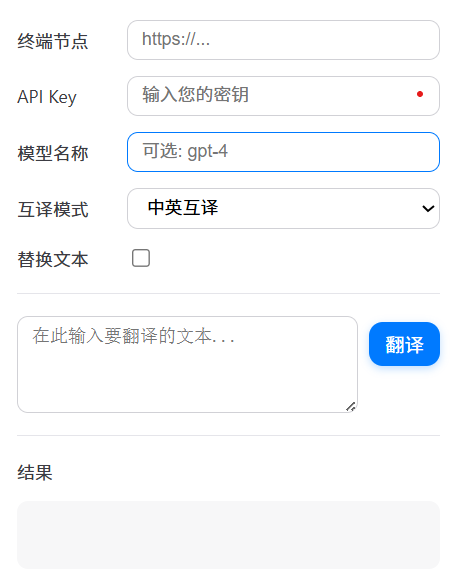
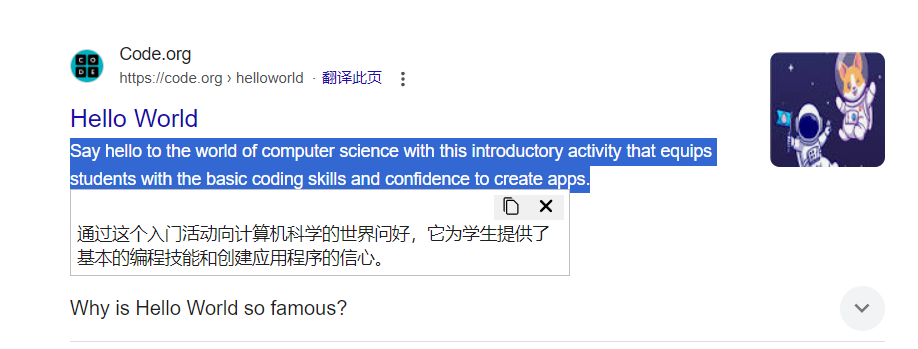
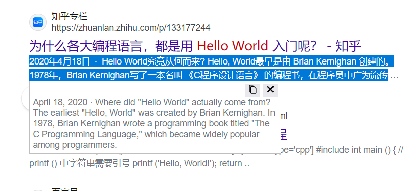

# 浏览器 LLM 翻译 · LLM Translator

[返回项目总览](../README.md)

通过自定义 LLM API 处理网页选中文本，支持中英互译、文本润色和自定义 Prompt。提供 Chrome / Edge 与 Firefox 两个版本，可在网页中展示悬浮结果、替换原文，或在扩展弹窗中手动输入。

## 功能

- 选中文本后，通过右键菜单或 `Alt+T` 执行当前翻译模式。
- 在网页中高亮选区并显示悬浮结果，或启用「替换文本」直接写回。
- 在扩展弹窗中手动翻译，并通过「结果」右侧按钮复制完整结果。
- 配置 API 请求地址、API Key、模型名称和翻译模式。
- 内置「中英互译」「中英润色」，支持新增、编辑和删除自定义模式。
- 在扩展本地存储中保存配置和 Prompt。

## 预览



| Chrome 网页效果 | Firefox 网页效果 |
| --- | --- |
|  |  |

## 安装

扩展无需构建，直接加载源码。请先下载或克隆仓库。

### Chrome / Edge

1. 打开 `chrome://extensions/` 或 `edge://extensions/`。
2. 开启「开发者模式」，点击「加载已解压的扩展程序」。
3. 选择 `llm-translation/chrome/`，该目录下直接包含 `manifest.json`。

### Firefox

1. 打开 `about:debugging#/runtime/this-firefox`。
2. 点击「临时载入附加组件」。
3. 选择 `llm-translation/firefox/manifest.json`。

临时加载的扩展会在 Firefox 重启后移除，需要重新加载。

## API 配置

点击扩展图标，填写以下配置。字段修改后会在失去焦点或选择变化时自动保存。

| 字段 | 说明 |
| --- | --- |
| 终端节点 | 完整的 Chat Completions 请求地址，不会自动补全路径；支持 `{{modelName}}` 占位符 |
| API Key | 接口密钥，保存在扩展的 `storage.local` 中 |
| 模型名称 | 按服务商要求填写；非空时加入请求体的 `model` 字段，并替换地址中的 `{{modelName}}` |
| 翻译模式 | 必选，决定使用哪条 Prompt |
| 替换文本 | 控制网页选区的输出方式，不影响弹窗内手动翻译 |

接口必须接受代码中的 Chat Completions 请求格式：POST JSON，`messages` 中包含 `user` 消息及文本内容数组，返回 `choices[0].message.content`。请求同时携带 `Authorization: Bearer <API Key>` 和 `api-key` 请求头。

地址示例：

```text
https://your-api.example/v1/chat/completions
```

若服务商把模型名放在路径中，可填写：

```text
https://your-api.example/openai/deployments/{{modelName}}/chat/completions
```

实际地址、模型名及所需查询参数以服务商提供的接口为准。

## 使用

### 网页选区翻译

1. 在普通网页中选中文本。
2. 右键选择「翻译选中的文本(LLM Translation)」，或按 `Alt+T`。
3. 默认以悬浮窗显示结果；启用「替换文本」后尝试替换选中内容。

Chrome / Edge 可在 `chrome://extensions/shortcuts` 或 `edge://extensions/shortcuts` 修改快捷键；Firefox 可在附加组件管理器中管理扩展快捷键。

### 手动输入翻译

1. 点击扩展图标，在输入框中键入或粘贴文字。
2. 点击「翻译」，结果会显示在弹窗中。
3. 点击「结果」一行右侧的复制按钮，复制完整结果。复制失败时可手动选择结果复制。

### 自定义 Prompt

在「新增模式」中填写名称和提示词，点击新增后即可选择。使用 `{{text}}` 表示原文位置；省略占位符时，程序会在提示词末尾追加原文。

```text
请将以下内容翻译为简洁、准确的中文技术文档，保留术语和数字，仅输出译文：

{{text}}
```

选择模式后，取消「锁定提示词」即可编辑，修改会自动保存。内置模式不可删除，其提示词在重新打开弹窗时会与代码中的默认值同步；需要长期保留的修改应保存为自定义模式。

## 使用范围与数据

- 网页翻译依赖脚本注入，浏览器内部页面、扩展商店等受限页面无法使用；可改用弹窗手动输入。
- 原文替换依赖网页控件实现，部分富文本编辑器可能不兼容。
- API Key 使用扩展本地存储，未使用系统凭据库；不要将浏览器版与桌面版、VS Code 版的密钥存储方式混淆。
- 执行翻译会把文本发送至配置的 API 服务，网络访问和接口兼容性取决于该服务及浏览器权限。

## 源码结构

```text
llm-translation/
├── chrome/              # Chrome / Edge，Manifest V3
│   ├── background.js    # 右键菜单、快捷键与网页结果展示
│   ├── function.js      # 默认 Prompt、存储读取与 API 请求
│   ├── popup.html       # 配置与手动翻译界面
│   ├── popup.js         # 配置保存、模式管理与结果复制
│   ├── manifest.json
│   └── icons/
├── firefox/             # Firefox，Manifest V2，同类文件布局
├── docs/                # 界面预览
└── README.md
```

## 版本记录

| 版本 | 变更 |
| --- | --- |
| 1.0.9 | 内置模式提示词更新后同步到存储 |
| 1.0.8 | 修复替换文本后部分 Input 组件状态回退的问题 |
| 1.0.7 | 支持终端节点中包含模型名称 |
| 1.0.6 | 修正扩展清单版本号 |
| 1.0.5 | 增加自定义 Prompt |
| 1.0.4 | 提取公共函数至 `function.js` |
| 1.0.3 | 调整弹窗样式 |
| 1.0.2 | 修复结果层级，增加选区黄色高亮 |
| 1.0.1 | 增加模型参数、中英互译、结果复制并优化样式 |
| 1.0.0 | 首次提供右键、快捷键、悬浮结果、原文替换和自定义 API |

## 许可证

[MIT License](../LICENSE)
